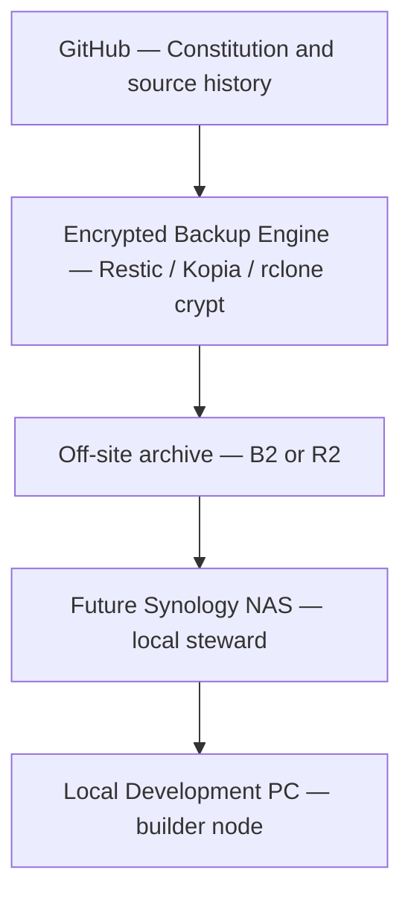

# Z-Sanctuary Preservation Architecture

**Initiative:** Project Lifeboat  
**Phase:** 0 target design (docs)  
**Date:** 2026-08-07  
**Status:** Recommended long-term design — **not** deployed by this document  

---

## 1. Design intent

| Old default (risk) | Lifeboat posture |
| --- | --- |
| PC as master of all truth | PC = builder node |
| Cloud as convenience sync | Cloud = independent preservation |
| Backup without restore | Restore drills as first-class |
| One place = “safe” | Multiple independent copies |

---

## 2. Target topology

```text
                    ┌─────────────────────────────┐
                    │  GitHub                      │
                    │  Constitution & source       │
                    │  history (living vault)      │
                    └──────────────┬──────────────┘
                                   │ cite / clone / PR
                                   ▼
                    ┌─────────────────────────────┐
                    │  Encrypted Backup Engine     │
                    │  Restic / Kopia / rclone     │
                    │  crypt (keys offline)        │
                    └──────────────┬──────────────┘
                                   │ encrypted objects only
                                   ▼
                    ┌─────────────────────────────┐
                    │  Independent Off-site        │
                    │  Backblaze B2  or  CF R2     │
                    │  (+ optional Tier A later)   │
                    └──────────────┬──────────────┘
                                   │ scheduled sync
                                   ▼
                    ┌─────────────────────────────┐
                    │  Future Synology NAS         │
                    │  Primary Local Steward       │
                    │  Hyper Backup / snapshots    │
                    └──────────────┬──────────────┘
                                   │ daily work
                                   ▼
                    ┌─────────────────────────────┐
                    │  Local Development PC        │
                    │  Builder · not fate master   │
                    └─────────────────────────────┘
```

Mermaid (same structure):



---

## 3. Layer duties

| Layer | Duty | Non-duty |
| --- | --- | --- |
| GitHub | Code, constitution docs, PR evidence, human merge on `main` | Bulk encrypted vault blobs |
| Encryption engine | Client-side encrypt; checksum; retention policy | Hold plaintext off-site |
| Off-site object store | Independent failure domain; durable storage | Become production app runtime |
| Synology NAS | Local steward; snapshots; Hyper Backup schedules | Public internet exposure without charter |
| PC | Build, verify, Turtle branches | Sole copy of stewardship truth |

---

## 4. Trust & key handling

- Encryption keys / passwords live in **human-controlled** offline or vault policy locations — **never** committed to hub git.  
- At least one sealed recovery key path known to AMK (and designated successor if named).  
- Restore drills prove key access, not only ciphertext presence.

---

## 5. Mapping to Wave 1

| Wave step | Architecture meaning |
| --- | --- |
| 1A Local staging | PC produces checksummed package (`LOCAL_STAGING`) |
| 1B Destination | First independent off-site (cloud or external drive AMK names) |
| 1C Verify + restore | Engine + destination proven |
| Phase 3 NAS | Local steward assumes schedule; PC demoted from master |

See [Z_WAVE_1B_DECISION_GUIDE.md](Z_WAVE_1B_DECISION_GUIDE.md) and hub [Z_BACKUP_WAVE1_RUNBOOK.md](../Z_BACKUP_WAVE1_RUNBOOK.md).

---

## 6. Independence rules

1. Off-site provider ≠ same physical site as PC alone.  
2. Prefer S3-compatible APIs for exit.  
3. Do not treat Cloudflare **Pages/Workers production** as the preservation certificate.  
4. GitHub + object store + (future) NAS = three different failure modes.

---

## 7. Growth path

| Era | State |
| --- | --- |
| Now (Phase 0–2) | Research → prototype → Wave 1B certificate |
| Near (Phase 3) | Synology arrives; automate; schedule restore verification |
| Far (Phase 4) | Annual health / cost / migration / DR drills through 2050+ |

---

## 8. Explicit non-goals

- Silent coupling Z-Sanctuary ↔ XL2 without charter  
- Auto-deploy of hub to edge because a bucket exists  
- Replacing GitHub history with object-store-only truth  

---

_Architecture · PC demoted · NAS steward · cloud independent · GitHub living history_
